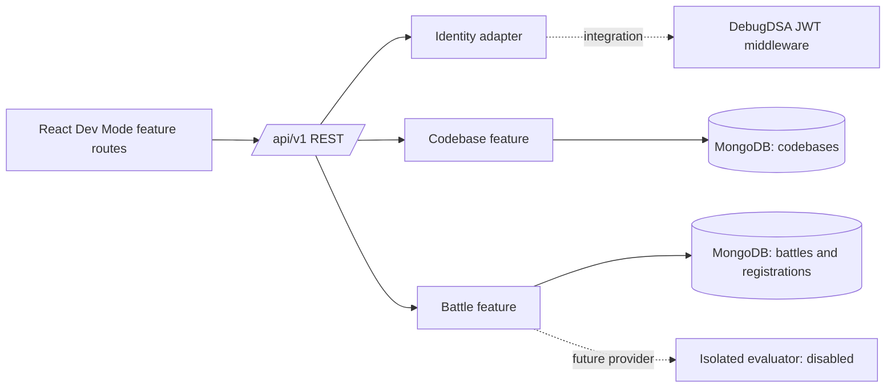

# Architecture

## Inspection and decision

Workspace inspection found an empty Git repository, no existing application files, and `origin` configured as `https://github.com/GkBuilds16/debugdsa-dev-mode.git`. The reference source at `https://github.com/vinut-hna-coder-6057/Debugdsa-website` is a separate React frontend and Express backend. Its source layout includes `backend/middleware/authMiddleware.js`, `backend/middleware/adminAuth.js`, Mongoose models and REST routes, plus a React app with shared `Authcontext`, `Navbar`, and `CodeEditor`. Its README identifies React 18, Express, MongoDB/Mongoose, JWT, and Socket.IO. This repository does not import or copy that application.

## Boundaries

The frontend entry point switches between discovery, battles, creator dashboard, and the Post Codebase editor. Creator dashboard/editor components live under `frontend/src/modules/post-codebase`. The backend mounts a dedicated creator router at `/api/v1/creator`; it delegates validation, lifecycle operations, file policy, ZIP parsing, local file storage, and response serialization to feature-specific modules. Older discovery, candidate-attempt, and battle handlers remain in `backend/src/app.js`, so the backend is not yet consistently layered. Identity is normalized to `{ id, roles }` and injected before feature routes.

## Decisions

- Vite is used for a compact independent React development mount; the reference currently uses Create React App. The built React feature can later be mounted under a platform route.
- MongoDB/Mongoose matches the observed platform persistence model.
- REST is used first. Socket.IO is not added until a live room needs actual shared realtime updates.
- Code execution is intentionally not implemented. No candidate content is executed in Express.
- Creator source files are stored under a private local directory using generated storage keys, with paths and metadata in MongoDB. ZIP ingestion is bounded and text-only; GitHub fetching remains disabled. Production needs durable shared/object storage before horizontal scaling.
- Development identity is explicitly gated by `AUTH_MODE=development` and rejected in production.

## Audit findings

Earlier foundation work fixed the `/api/v1` mount, dotenv initialization, and explicit creator/admin authorization. Post Codebase now uses router, service, validator, and serializer boundaries; public and creator serializers are separate. Existing candidate/battle routes still live in `backend/src/app.js`. Publish snapshots and the active codebase state use separate MongoDB writes without a transaction. MongoDB connectivity and deployment storage behavior were not verified in this environment.
