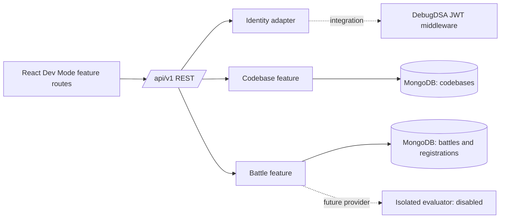

# Architecture

## Inspection and decision

Workspace inspection found an empty Git repository, no existing application files, and `origin` configured as `https://github.com/GkBuilds16/debugdsa-dev-mode.git`. The reference source at `https://github.com/vinut-hna-coder-6057/Debugdsa-website` is a separate React frontend and Express backend. Its source layout includes `backend/middleware/authMiddleware.js`, `backend/middleware/adminAuth.js`, Mongoose models and REST routes, plus a React app with shared `Authcontext`, `Navbar`, and `CodeEditor`. Its README identifies React 18, Express, MongoDB/Mongoose, JWT, and Socket.IO. This repository does not import or copy that application.

## Boundaries

Frontend API calls are isolated in the current application entry point; feature services can be extracted as additional screens mature. Backend routes are split between creator codebases, public discovery, and battle registration. Mongoose models are feature-specific. Identity is normalized to `{ id, roles }` and injected before feature routes.

## Decisions

- Vite is used for a compact independent React development mount; the reference currently uses Create React App. The built React feature can later be mounted under a platform route.
- MongoDB/Mongoose matches the observed platform persistence model.
- REST is used first. Socket.IO is not added until a live room needs actual shared realtime updates.
- Code execution is intentionally not implemented. No candidate content is executed in Express.
- Source files are currently stored as bounded document content; production deployments should move bundles to a storage adapter before accepting archives or large projects.
- Development identity is explicitly gated by `AUTH_MODE=development` and rejected in production.

## Audit findings

The initial audit fixed a missing `/api/v1` mount for health and public discovery, moved dotenv loading before dynamic app import so environment settings are applied when middleware is configured, and added explicit creator/admin authorization. Current route handlers still live together in `backend/src/app.js`; there are not yet separate controller, service, validator, and repository layers. This is the main structural debt to address incrementally while adding modules. No broad rewrite was made during the audit.
