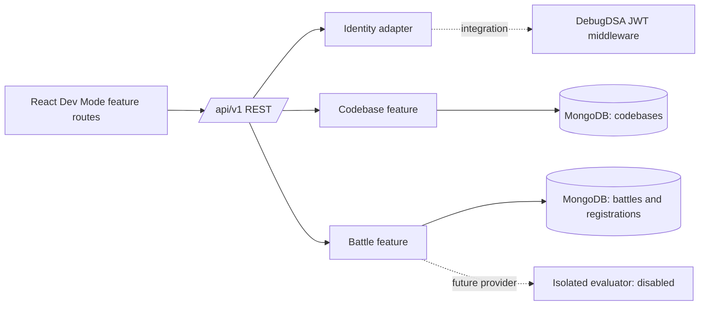

# Architecture

## Inspection and decision

This repository is an independent React/Vite frontend and Express/Mongoose API. It does not contain the host platform's login, profiles, navigation, or JWT middleware, and it does not modify the original DebugDSA application. Its architecture is organized by feature module with shared identity, file policy/storage, API client, and layout integration points.

## Boundaries

The frontend entry point switches between candidate discovery/workspace, battles, creator dashboard, and the Post Codebase editor. Creator dashboard/editor components live under `frontend/src/modules/post-codebase`; candidate screens live under `frontend/src/modules/view-codebases`; battle organizer/candidate UI lives under `frontend/src/modules/battles`. A shared API client reads a bearer token from `window.DebugDSAAuth.getAccessToken()` when the host provides it; this host integration is not present here. The backend mounts creator, candidate, and battle routers beneath `/api/v1`; each feature separates routes, controllers, services, validators, serializers, and provider boundaries. MongoDB stores metadata and generated local storage keys; source contents and submission snapshots live in private local storage. Identity is normalized to `{ id, roles }` and injected before protected feature routes.

## Decisions

- Vite is used for a compact independent React development mount; the reference currently uses Create React App. The built React feature can later be mounted under a platform route.
- MongoDB/Mongoose matches the observed platform persistence model.
- REST is used first. Socket.IO is not added until a live room needs actual shared realtime updates.
- Code execution is intentionally not implemented. No candidate content is executed in Express.
- Creator source files are stored under a private local directory using generated storage keys, with paths and metadata in MongoDB. ZIP ingestion is bounded and text-only; GitHub fetching remains disabled. Production needs durable shared/object storage before horizontal scaling.
- Candidate workspaces store per-candidate file overrides and revision numbers; submissions copy the candidate files into distinct immutable storage objects. Candidate reads are owner-scoped, while public codebase detail omits interviewer-only material and source contents. Evaluation always returns `NOT_EVALUATED`; no source code is run.
- Battles reference one immutable `CodebaseVersion` and its source objects instead of copying challenge files. Each registration receives a private version-bound workspace and one immutable submission. Lifecycle is derived from server timestamps and refreshed at startup and periodically; REST polling is the only live-state adapter. Without a verified evaluator, ended battles expose submission status only and do not generate rankings.
- If a verified evaluator is added later, the documented deterministic order is verified score descending, verified completion time ascending, final submission timestamp ascending, then candidate ID ascending. This is a future rule only; current API results set `rankings` to `null`.
- Development identity is explicitly gated by `AUTH_MODE=development` and rejected in production.

## Audit findings

Earlier foundation work fixed the `/api/v1` mount, dotenv initialization, and explicit creator/admin authorization. Post Codebase, View Codebases, and Battles use separate feature routers. Battle capacity uses a conditional MongoDB update followed by a unique registration insert with compensating rollback; it is not a multi-document transaction. Codebase publishing and local file/database coordination also use separate writes. MongoDB connectivity, index creation, durable storage, and deployment behavior have not been verified in this environment. Legacy battles without a version reference are hidden from candidate discovery pending a reviewed migration.

Route modules and the top-level React page components are sizable and combine endpoint/view composition with control flow. Shared file policy and storage reduce duplication, while candidate and battle serializers intentionally stay separate to keep response privacy explicit. No refactor was needed for the audit; integration readiness limitations are captured in the [verification matrix](verification-matrix.md).
